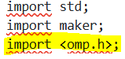
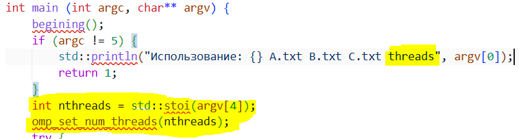
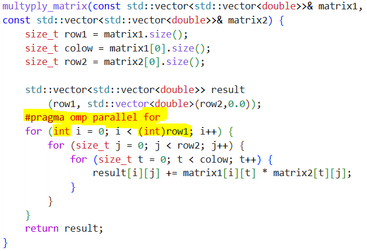
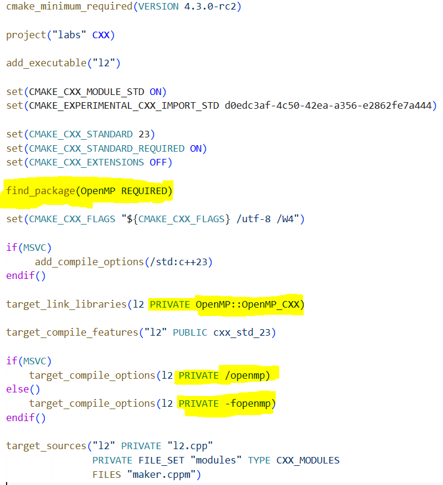

# Задание
- Модифицировать программу из л/р №1 для параллельной работы по технологии OpenMP.  
- Провести серию экспериментов с разным количеством потоков (1, 2, 4, 8 и т.д.), разными размерами матриц (примерно 200, 400, 800, 1200, 1600, 2000), с разным количеством вычислительных ядер при наличии технической возможности (1, 2, 4, 8 и т.д. ), иначе использовать фиксированное существующее количество вычислительных ядер, например 4.
# Было реализовано
Модификация уже существующей программы на С++ из lab1 (см lab1/l1.cpp и lab1/maker.cppm) с помощью библиотеки OpenMP:

для lab2.cpp --->
-  >> Подключение omp.h с помощью header unit. Использовано вместо #include <omp.h> во избежание конфликтов с import std. Важное уточнение: для сборки использовался MSVC (Visual Studio 2022), где header units для C-заголовков поддерживаются стабильно.
-  >> std::stoi(argv[4]) — преобразование строкового аргумента в int. Выбрасывает std::invalid_argument, если аргумент не является числом >> omp_set_num_threads(nthreads) — вызов функции OpenMP, задающей число потоков для всех последующих параллельных секций.

для maker.cppm --->
-  >> Цикла for (int i = 0; i < (int)row1; i++) {...} строкой #pragma omp parallel for распараллеливается на несколько потоков. Так как OpenMP требует знаковый целочисленный тип, к которому size_t не относится, то мы преобразуем тип переменной row1 в int. Внутренние циклы не подвергаются распараллеливанию, поэтому для них преобразование переменных row1 и colow не требуется. 

На потоки разбит именно первый из 3х циклов, по причинам:
- result[i][-] не пересекается с другими строками.
- каждый поток работает с разными строками result[i][...], поэтому запись в память не пересекается между потоками => синхронизация не требуется
- потоки создаются один раз, строки по потокам распределяются тоже один раз.

для CMakeLists.txt ---> 
-  >> find_package(OpenMP REQUIRED) — поиск библиотеки OpenMP в системе >> target_link_libraries(l2 PRIVATE OpenMP::OpenMP_CXX) — линковка найденной библиотеки с целевым исполняемым файлом l2. CMake создаёт цель OpenMP::OpenMP_CXX автоматически и включает в неё все необходимые пути и флаги >> Кроссплатформенные флаги компиляции (для MSVC — /openmp, для GCC/Clang — -fopenmp). Оба флага активируют обработку директив #pragma omp компилятором, запуская программу в многопоточном режиме.
# Рассмотрим результаты разделения программы для нескольких потоков 
(в конце документа приведено несколько скриншотов для подтвержения достоверности данных)
| | |
|---|---|
|  |  |

Расчитаем ускорение и процент эффективности по формулам: S(p)=t1/tp и E(p)=S(p)/p×100% соответсвенно, где t1 — время выполнения с помощью 1 потока, tp — время выполнение с помощью p потоков (следовательно p — кол-во потоков):

На малых матрицах (N ≤ 100) ускорение незначительно, так как время выполнения близко к накладным расходам OpenMP на создание и синхронизацию потоков. С ростом N доля накладных расходов уменьшается, и ускорение приближается к линейному. При этом, так как при вычислении больших матриц последовательная часть программы (чтение и запись) увеличивается в объёме, поэтому ускорение не может расти линейно и ограничивается некоторым предельным значением.
Так же, с ростом числа потоков эффективность падает из-за ограниченности ресурсов и в конечном счёте сильно зависит от N (оптимальный вариант — 4 потока).

# Выводы 
- OpenMP даёт значительное ускорение на больших матрицах.
- Ускорение нелинейно и ограничено из-за наличия в программе последовательных операций.
- С ростом числа потоков падает эффективность. Оптимальный вариант — 4 потока.