# Задание
- Модифицировать программу из л/р №1 для параллельной работы по технологии MPI.  
- Провести серию экспериментов с разным количеством потоков (1, 2, 4, 8 и т.д.), разными размерами матриц (примерно 200, 400, 800, 1200, 1600, 2000), с разным количеством вычислительных ядер (1, 2, 4, 8 и т.д. ).
- Запустить параллельную версию программы на MPI на суперкомпьютере «Сергей Королёв».
# Было реализовано
Модификация уже существующей программы на С++ из lab1 (см lab1/l1.cpp и lab1/maker.cppm) с помощью библиотеки MPI:

для lab3.cpp --->
- Подключение mpi.h с помощью header unit. Использовано вместо #include <mpi.h> во избежание конфликтов с import std. Важное уточнение: для сборки использовался MSVC (Visual Studio 2022), где header units для C-заголовков поддерживаются стабильно.

- 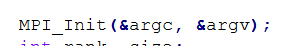 Запуск среды MPI. Передача 4х аргументов командной строки.

- 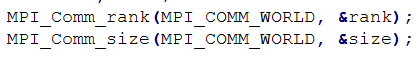 В переменную rank записывается номер уникальный процесса, в переменную size - общее кол-во активных процессов (кол-во используемых ядер). MPI_COMM_WORLD - обьединяет все процессы в сообщающуюся группу.

- 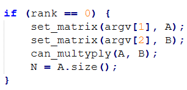 Чтение матриц осуществляется через главный процесс, чтобы файлы читались ровно по одному разу и непосредственно перед началом вычислений и не тормозили остальные процессы.

- 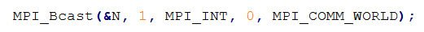 Передача информации о размере матриц (значит и о размере результирующей матрицы) от главного процесса остальным. 

- 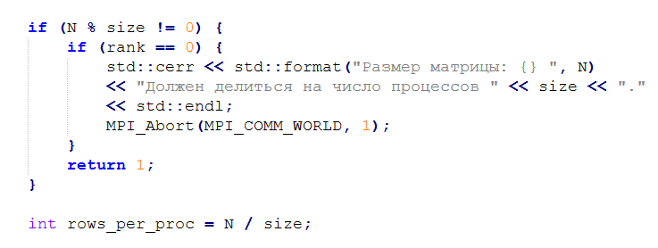 Следом проверяется делимость кол-ва процессов на кол-во используемых ядер (важно для корректного разделения процессов, иначе пока кто-то уже закончил вычисления, другой будет его ждать). В случае несоответствия размеров и кол-ва ядер программа аварийно завершается. В противном случае высчитывается объём вычислений для каждогоо отдельного процесса.

- 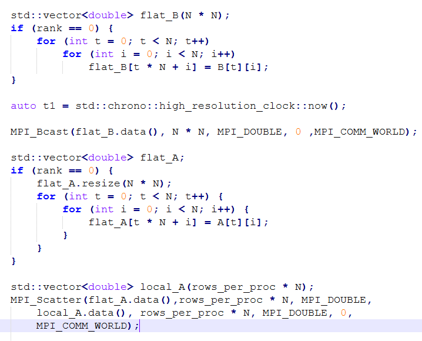 Далее матрицы нужно подготовить к вычислению (разложить в одномерный массив (тк MPI не способен напрямую передавать двумерные массивы, он работает только с непрерывной памятью и массив указателей на массивы не поймёт). MPI_Bcast рассылает получившийся массив на все процессы). Для матрицы А процесс подготовки немноого отличается, тк именно она является объектом умножения на матрицу B. Матрица А делится на отдельные куски (их размер зависит от размера матрицы и объёма вычислений для каждого процесса). Результат перемножения потом будет передоваться в local_A.data().

- 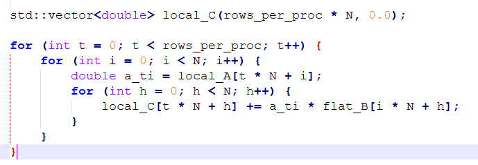 Каждый процесс отдельно выполняет перемножение каждого куска матриц.

- 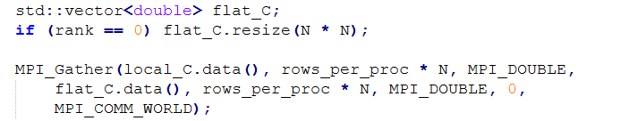 В конце все куски от каждого процесса собираются в цельную матрицу

- При выбрасывании исключений для экстренной остановки всех параллельных процессов используется MPI_Abort(MPI_COMM_WORLD, 1).

для CMakeLists.txt ---> 

- 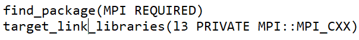 Поиск установленной библиотеки (если MPI не будет найден, маркер REQUIRED остановит сборку программы) и привязывание её к исполняемому файлу.

для maker.cppm --->
- Функция multiply_matrix не была реализована из-за смены алгоритма перемножения матриц (умножаем по частям, а не целиком)

Примечание:
- Для реализации запуска на суперкомпьютере код програмы l3.cpp и модуля maker.cpp был упрощён: отказ от сборки через CMake, взамен использование скрипта (см в папке "запуск на суперкомпьютере"), использование с++11 стандарта языка (#include и <iostream>), отказ от использования модулей.

# Рассмотрим результаты разделения программы для нескольких потоков 
| | |
|---|---|
| 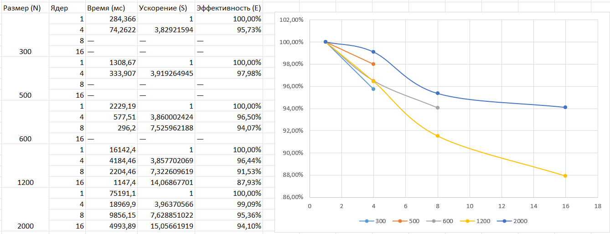 | 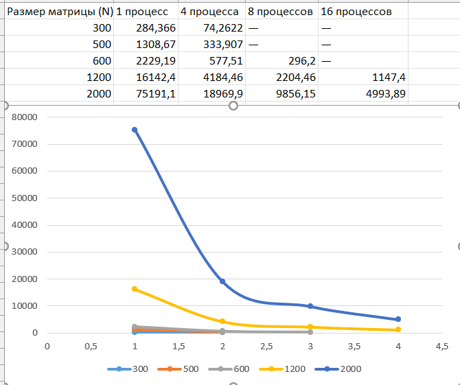 |

Для каждого отдельного размера матриц ускорение считалось как отношение времени выполнения 1 процесса ко времени выполнения n процессов (см. файл таблицы.xlxs). Эффективность работы каждого отдельного ядра считалась как отношение ускорения к количеству процессов. 

# Выводы 
Ввремя выполнения программы при увеличении числа процессов с 1 до 16 уменьшается почти линейно. Максимальное ускорение достигнуто для матрицы размером 2000х2000 и составило 15,06 раз при эффективности 94,1%. Расхождение с теоретическим ускорением связано с расходами на передачу данных между процессами (MPI_Bcast и MPI_Scatter), а так же с тем, что при чтении  и записи данных часть программы выполняется главным процессом последовательно, что тормозит выполнение программы. 